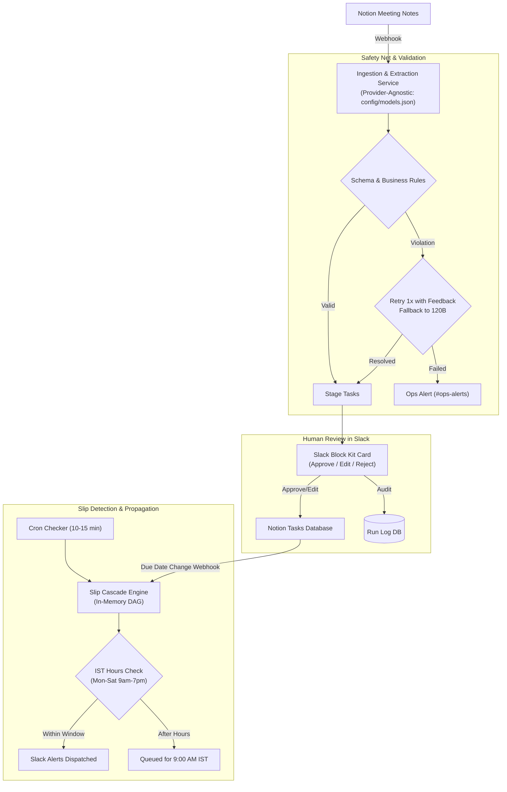
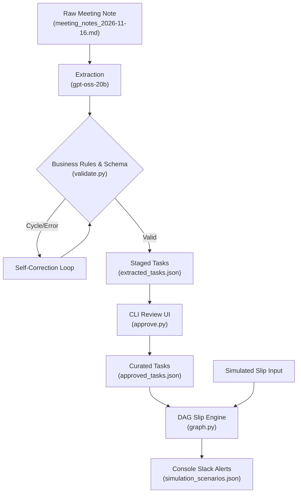

# Product Engineering Build Plan: AI Task Extraction & Slip Cascade Engine

---

## 1. What We Ship First & Why
We ship multilingual task extraction, human review staging, and the downstream slip cascade engine first because schedule slip alerts across dependent chains are the core problem founders face and what the trial measures; without reliable extraction and human validation, there are no trustworthy commitments to track. Automated priority ranking is deferred to v2 to keep v1 strictly focused on verifying the core dependency chain and delay mechanics.

---

## 2. Production System Architecture

---

## 3. Core Data Model

| Entity | Fields | Description & Relationships |
| :--- | :--- | :--- |
| **Goals** | `id`, `name`, `target_date`, `weight` (1–3), `status` | High-level company milestones. Status rolls up from child tasks. |
| **Tasks** | `id`, `title`, `owner`, `due_date`, `goal_id`, `depends_on`, `estimated_duration_days`, `status`, `confidence`, `needs_confirmation`, `source_quote` | Committed Notion deliverables. `owner` maps to Team; `goal_id` maps to Goal; `depends_on` lists parents; `status`: `safe`, `at_risk`, `broken`. |
| **Meetings** | `id`, `date`, `raw_notes`, `status` | Source meeting records. Status: `ingested`, `pending_review`, `committed`. |
| **Run Log** | `run_id`, `timestamp`, `meeting_id`, `model`, `prompt_tokens`, `completion_tokens`, `cost_usd`, `outcome`, `human_decisions` | Audit trail of LLM prompts, token telemetry, extraction outcomes, and reviewer edits/rejections. |

---

## 4. Buy vs. Build

| Component | Choice | Rationale |
| :--- | :--- | :--- |
| **Notion** | **Buy** | Team workspace and canonical task database; avoids building a bespoke task UI. |
| **Slack** | **Buy** | Interaction layer for review cards and mobile/desktop alert delivery. |
| **LLM Inference** | **Buy** | Groq / OpenAI / Anthropic APIs; configured via `config/models.json` for easy switching. |
| **Cloud Hosting** | **Buy** | Render / Railway / AWS Lambda for webhook listener and cron worker ($5–$10/mo). |
| **Extraction & Validation** | **Build** | Custom prompts and Pydantic rules to resolve informal multilingual Indian speech, relative dates, and speaker-assignee rules. |
| **Slip Cascade Engine** | **Build** | In-memory DAG separating task duration from slack to propagate transitive delay; off-the-shelf tools cannot model buffer erosion. |

---

## 5. Production Runbook (3 Common Failures & Fixes)

1. **Notion API Error (Rate limit, auth expired, schema mismatch):**
   - *Fix:* Buffer failed mutations in a dead-letter queue with exponential backoff (1m, 5m, 15m). If still failing after 3 attempts, alert `#ops-alerts` in Slack with payload links.
2. **Model Returns Bad Output (Invalid schema, circular dependency, unverified owner):**
   - *Fix:* Validator catches violation, feeds error text back for 1x self-correction, then escalates to 120B fallback model. If still failing, dispatches plain-English Slack triage card with raw note link.
3. **Slack Alert Delivery Failure (Invalid handle, rate limit, DM closed):**
   - *Fix:* Mark alert `pending` and retry with jitter. If direct DM fails, post to `#project-alerts` tagging `@project-lead`.

---

## 6. Estimated Monthly Operating Cost

*Assumptions: 20-person startup, 40 meetings/month, 15% retry assumption, 5% fallback escalation assumption.*

| Component | Basis | Monthly Cost |
| :--- | :--- | :--- |
| **LLM Inference (`gpt-oss-20b`)** | 40 runs @ ~$0.00032/run + 15% retry allowance | ~$0.015 |
| **Fallback Escalations (`gpt-oss-120b`)** | 2 runs/month @ ~$0.0014/run | ~$0.003 |
| **Cloud Hosting (Render / Railway / Lambda)** | Webhook listener + 10-min cron worker | $5.00 – $10.00 |
| **Notion & Slack Workspaces** | Existing team subscriptions | $0.00 |
| **Total Monthly Operating Cost** | **Complete production infrastructure** | **~$5.02 – $10.02 / month** |

---

## Appendix: Prototype Verification & Findings

### A1. Prototype Architecture ("What the Demo Covers")

### A2. Model Routing & 20B Reasoning Findings
- **Discovery:** `openai/gpt-oss-20b` initially hit Groq's 2,048 token limit because default reasoning spent 2,046 tokens on internal chain-of-thought before emitting JSON.
- **Fix:** Setting `reasoning_effort="low"` dropped reasoning to **578 tokens**. With `max_completion_tokens=4096`, the model worked on my test note reliably on attempt 1 (~$0.00032/run).
- **Agnostic:** Model IDs sit in `config/models.json`; switching providers is a one-line config change.

### A3. What the Demo Demonstrates vs. Does Not Prove
- **Demonstrates:** Interception and self-correction of injected cycles/bad owners (`--simulate-break`), duration vs. slack separation into `broken`/`at_risk`/`safe`, IST business hour alert queuing, and consistent relative date resolution across 5 runs.
- **Does Not Prove:** Performance on messy, uncurated audio transcripts.
- **Hand-Curated Disclosure:** `data/approved_tasks.json` was hand-curated during human review to supply task-4's due date (`2026-12-05`), resolve a duplicate joint review, prune redundant task-7, and link task-6 to task-5.
- **Unowned Items Gap:** v1 prompt sometimes drops unowned proposals; v2 surfaces ignored remarks on the review screen for manual recovery.

### A4. Multi-Run Benchmark Summary (5 Runs)
- **Results:** 5 out of 5 runs passed validation; core 5 committed tasks were invariant with zero chatter leakage.
- **Task Wobble (5 to 8 tasks):** Minor wobble occurred on borderline conversational remarks (e.g. unassigned carton inquiries), confirming human review is an essential design rule.

### A5. Production Roadmap (v2 Native Stack)
1. **Notion Automations & Webhooks:** Native triggers on database page edits to detect due-date slips automatically.
2. **Slack Block Kit Action Cards:** Interactive Slack messages for one-click task approvals, date edits, or dependency rewires.
3. **Notion AI Meeting Notes:** Direct ingestion of Notion's AI-generated meeting summaries.
4. **Calendar & Regional Holiday Awareness:** Account for regional closures (e.g., Diwali week in Ahmedabad) when computing projected finishes.
