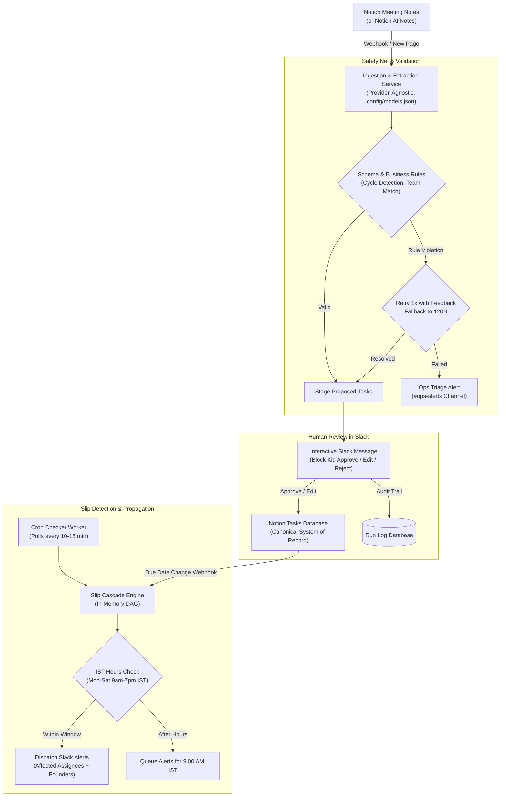
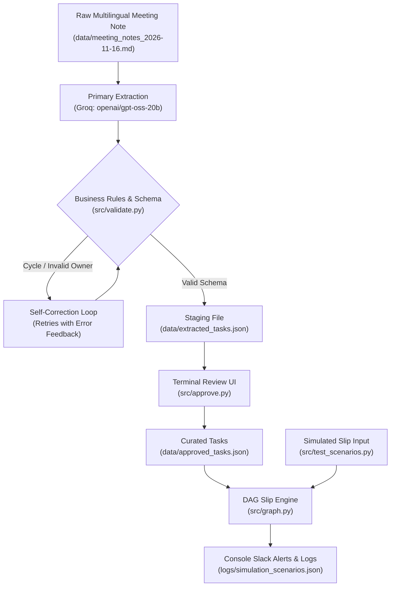

# Product Engineering Build Plan: AI Task Extraction & Schedule Slip Cascade Engine

---

## Executive Summary & Production Plan (Page 1)

### 1. What We Ship First & Why
We ship multilingual meeting task extraction, human review staging, and the downstream slip cascade engine first because schedule slip alerts across dependent chains are the core problem founders face and what the trial's pass test measures; without reliable extraction and human validation, there are no trustworthy commitments to track. Automated priority ranking is deferred to v2 to focus strictly on verifying the core dependency chain and delay mechanics before introducing heuristic priority weighting.

### 2. Production System Architecture

### 3. Core Data Model

| Entity | Key Fields | Description & Relationships |
| :--- | :--- | :--- |
| **Goals** | `id`, `name`, `target_date`, `weight` (1–3), `status` | High-level company milestones set by founders. Status rolls up from child tasks. |
| **Tasks** | `id`, `title`, `owner`, `due_date`, `goal_id`, `depends_on`, `estimated_duration_days`, `status`, `confidence`, `needs_confirmation`, `source_quote` | Committed deliverables in Notion. `owner` maps to Team; `goal_id` maps to Goal; `depends_on` lists prerequisite task IDs; `status` is `safe`, `at_risk`, or `broken`. |
| **Meetings** | `id`, `date`, `raw_notes`, `status` | Source meeting documents. Status: `ingested`, `pending_review`, `committed`. |
| **Run Log** | `run_id`, `timestamp`, `meeting_id`, `model`, `prompt_tokens`, `completion_tokens`, `cost_usd`, `outcome`, `human_decisions` | Audit record of LLM prompts, token telemetry, extraction outcomes, and reviewer edits/rejections. |

### 4. Buy vs. Build

- **Buy (Notion):** Team workspace and canonical task database; no need to build a bespoke project management UI.
- **Buy (Slack):** Communication interface for interactive review cards and mobile/desktop alert delivery.
- **Buy (LLM API):** Groq / OpenAI / Anthropic for inference; model choice is abstracted into `config/models.json` so switching providers is a config change.
- **Buy (Cloud Hosting):** Render / Railway / AWS Lambda for running the webhook listener and cron worker ($5–$10/mo).
- **Build (Multilingual Extraction & Validation):** Custom prompt and Pydantic business validator to resolve informal Indian startup speech (Hindi/Gujarati/English), relative dates, and speaker-assignee rules.
- **Build (Slip Cascade Engine):** In-memory DAG that separates task duration from schedule slack to propagate delays downstream; off-the-shelf tools (Notion, Asana) treat tasks as flat records and cannot compute transitive buffer erosion.

### 5. Production Runbook (3 Common Failures & Fixes)

1. **Notion API Error (Rate limit, expired token, or schema mismatch):**
   - *Fix:* Worker buffers failed mutations in a dead-letter queue with exponential backoff (1m, 5m, 15m). If still failing after 3 attempts, it alerts `#ops-alerts` in Slack with payload links so commitments are never dropped.
2. **Model Returns Bad Output (Invalid schema, circular dependency, unverified owner):**
   - *Fix:* Schema validator catches the violation, feeds exact error text back to the model for 1x self-correction, and escalates to a 120B fallback model if needed. If all retries fail, it posts a plain-English Slack triage card: *"Could not parse meeting note due to cyclic dependency; click to review raw text."*
3. **Slack Alert Delivery Failure (Invalid user handle, webhook rate limit, or DM closed):**
   - *Fix:* Alerts are stored with delivery status `pending` and retried with jitter. If direct DM fails, alert falls back to posting in the public `#project-alerts` channel tagging `@project-lead`.

### 6. Estimated Monthly Operating Cost

*Assumptions: 20-person startup, 10 meetings/week = 40 meetings/month, 15% retry rate assumption, 5% fallback escalation assumption.*

| Component | Basis | Monthly Cost |
| :--- | :--- | :--- |
| **LLM Inference (`gpt-oss-20b`)** | 40 runs @ ~$0.00032/run + 15% retry allowance | ~$0.015 |
| **Fallback Escalations (`gpt-oss-120b`)** | 2 runs/month (5% assumption) @ ~$0.0014/run | ~$0.003 |
| **Cloud Hosting (Render / Railway / Lambda)** | Always-on webhook listener + 10-min cron worker | $5.00 – $10.00 |
| **Notion & Slack Workspaces** | Existing team subscriptions | $0.00 |
| **Total Monthly Operating Cost** | **Complete production infrastructure** | **~$5.02 – $10.02 / month** |

---

## Appendix: Empirical Findings & Prototype Verification

### A1. Prototype Architecture ("What the Demo Covers")

The prototype built for this submission validates the risky core logic (LLM decoding, validation feedback, DAG math) locally before connecting production APIs:

### A2. Model Routing & 20B Reasoning Findings
During prototyping on `openai/gpt-oss-20b`, the model initially failed with empty completions and HTTP 400 errors:
- **Root Cause:** As an open reasoning model, default parameters allowed it to spend **2,046 tokens** on internal chain-of-thought, hitting Groq's 2,048 completion limit (`finish_reason: length`) before emitting JSON.
- **Empirical Fix:** Setting `reasoning_effort="low"` reduced reasoning burn to **578 tokens**. Combined with expanding `max_completion_tokens=4096`, the model worked on my test note reliably on attempt 1.
- **Provider Agnostic:** The model ID sits in `config/models.json`; switching to OpenAI or Anthropic requires only a config update without touching application code.

### A3. What the Demo Does and Doesn't Prove

- **What it Demonstrates:**
  1. *Safety Net Wiring:* The `--simulate-break` test demonstrates that injected cyclic dependencies and unknown owners are caught by business rules, fed back into the context, and corrected on attempt 2.
  2. *Cascade Math:* Separating task duration from schedule slack correctly distinguishes downstream status into 🔴 **BROKEN**, 🟡 **AT_RISK**, and 🟢 **SAFE**.
  3. *Alert Timing:* Correctly calculates IST business hours (Mon–Sat, 9am–7pm IST) and queues off-hours alerts until 9:00 AM.
  4. *Date Normalization:* In 5 out of 5 runs on our test note, relative temporal anchors ("Friday", "Wednesday") mapped accurately to ISO dates (`2026-11-20`).

- **What it Does NOT Prove:**
  1. *Real Messy Audio:* Tested on a synthetic benchmark note, not noisy speech-to-text transcripts with disfluencies or ambient chatter.
  2. *Automated Pipeline Output of `approved_tasks.json`:* **Honest Disclosure:** The `approved_tasks.json` dataset used for the graph engine was **hand-curated** by human review. A human was required to specify the committed date for task-4 (`2026-12-05`), resolve a duplicate joint review, prune redundant task-7, and link task-6 to task-5.
  3. *Zero-Touch Extraction:* Human approval is an intentional design rule because boundary detection on informal conversational proposals naturally varies.

### A4. Multi-Run Consistency Benchmark (5 Runs)
Across 5 benchmark runs of the primary model at `temperature=0.1` ([stability_5runs.json](file:///Users/srijantelang27/Desktop/Personal/product/logs/stability_5runs.json)):
- **Invariant Core:** All 5 core committed tasks were extracted in 5 out of 5 runs with zero chatter intrusion.
- **Task Count Wobble (6 to 7 tasks):** Output counts wobbled between 6 and 7 because borderline conversational remarks (e.g. unassigned carton inquiries) were intermittently flagged as unassigned tasks vs. filtered remarks.
- **Known Gap on Unowned Items:** v1 sometimes drops unowned proposals or routes them to `ignored_remarks`; v2 addresses this by surfacing ignored remarks directly in the review screen.

### A5. Prototype Boundaries & Production Targets

| Area | Prototype Boundary | Production Target |
| :--- | :--- | :--- |
| **Review UI** | Interactive terminal CLI (`src/approve.py`). | Slack Block Kit message with interactive buttons. |
| **Duration Input** | Manually specified via `estimated_duration_days`. | Historical completion velocity calculated from Notion. |
| **Unowned Tasks** | Filtered by prompt; occasionally dropped. | Review screen displays ignored remarks for optional recovery. |
| **Slip Trigger** | CLI argument simulation. | Notion webhook + 10-15 min background polling worker. |
| **Priority Ranking** | Deferred to v2. | Eisenhower matrix combining goal weight with critical path urgency. |

### A6. Production Roadmap (v2 Native Stack)
1. **Notion Automations & Webhooks:** Native triggers on database page edits to detect due-date slips automatically.
2. **Slack Block Kit Action Cards:** Interactive Slack messages allowing one-click task approvals, date edits, or dependency rewires.
3. **Notion AI Meeting Notes as Ingestion Source:** Directly ingest Notion's native AI-generated meeting summaries as high-quality, pre-transcribed inputs.
4. **Calendar & Regional Holiday Awareness:** Account for regional office closures (e.g., Diwali week in Ahmedabad) when computing projected finishes and buffer erosion.
