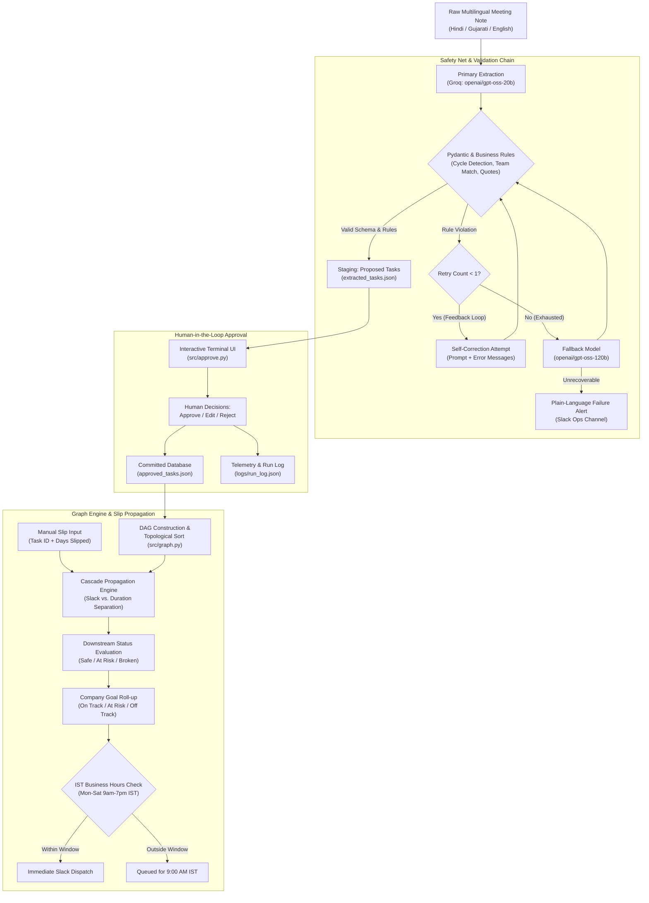

# Product Engineering Build Plan: AI Task Extraction & Schedule Slip Cascade Engine (v1)

## 1. Executive Summary & v1 Scope

This system automates the lifecycle of commitments made in messy, multilingual startup meetings by extracting structured action items, routing them through human approval, and modeling dependencies in a Directed Acyclic Graph (DAG). When upstream bottlenecks or delays occur, the engine propagates schedule slips through the DAG to evaluate critical paths, compute goal risk, and generate actionable, time-zoned Slack alerts. In v1, the scope is strictly bounded to reliable LLM extraction, deterministic business validation, interactive human review, and downstream slip cascade simulation, with Notion and Slack integrations simulated via structured local schemas.

---

## 2. End-to-End System Architecture

The following diagram illustrates the complete execution pipeline from raw meeting transcript ingestion to schedule slip alerting:

---

## 3. Model Routing Strategy & Empirical Findings

### 3.1 The 20B Reasoning Model Configuration Discovery
During initial prototyping, `openai/gpt-oss-20b` failed catastrophically with empty output strings and HTTP 400 JSON validation errors. 

Investigation revealed this was **not a multilingual capability limit**, but an output token budget exhaustion caused by internal reasoning:
1. **The Root Cause:** `openai/gpt-oss-20b` is an open-weights reasoning model. Under default settings, it spent **2,046 tokens** on internal chain-of-thought, hitting Groq's default 2,048 completion token ceiling (`finish_reason: length`) before emitting a single token of the JSON payload.
2. **The Empirical Fix:** Setting `reasoning_effort="low"` in the Groq API call drastically curtailed reasoning token consumption from **2,046 to 578 tokens**. Combined with expanding `max_completion_tokens=4096`, the model produced valid, high-fidelity JSON on attempt 1.
3. **Product Takeaway:** Cheap, lightweight reasoning models are fully capable of multilingual extraction and complex JSON formatting, provided token budgets and reasoning effort are configured properly.

### 3.2 Resilience & Escalation Architecture
The extraction pipeline implements a progressive 3-tier safety net:
- **Tier 1 (Primary):** `openai/gpt-oss-20b` (`temperature=0.1`, `reasoning_effort="low"`). Fast, low latency (~1.5s), and cost-effective.
- **Tier 2 (Self-Correction Retry):** If schema validation or business rules fail (e.g., circular dependency or unknown owner), the pipeline captures the exact validation errors, appends them to the conversation context, and requests a correction from the 20B model.
- **Tier 3 (Fallback Escalation):** If the primary model fails twice or hits unresolvable length limits, the pipeline automatically escalates to `openai/gpt-oss-120b`.
- **Circuit Breaker:** If all attempts fail, the pipeline aborts cleanly and posts a structured failure notification formatted for a triage Slack channel.

### 3.3 Telemetry & Unit Economics
Every extraction run appends full audit telemetry to `logs/run_log.json`.
- **Average Prompt Tokens:** ~2,627 tokens (includes system instructions, meeting text, team roster, goal context)
- **Average Completion Tokens:** ~1,238 tokens (includes internal reasoning + JSON schema)
- **Primary Model Cost (`gpt-oss-20b`):** $0.000321 USD per meeting run.

---

## 4. What the Demo Does and Doesn't Prove

To maintain absolute product integrity and avoid overclaiming, we clearly distinguish between verified engineering logic and prototype simplifications.

### 4.1 What the Demo PROVES
1. **Safety Net Wiring & Self-Correction:** The `--simulate-break` test conclusively proves that corrupt model outputs (injected cycles, fake team owners) are deterministically intercepted by business rules, fed back into the context window, and self-corrected without human intervention.
2. **Deterministic Cascade Mechanics:** The engine mathematically separates **work duration** from **schedule buffer/slack**. It accurately proves that downstream tasks absorb upstream delays when slack is sufficient (SAFE), warn assignees when buffers erode below safety thresholds (AT_RISK), or flag bottlenecks when deadlines are violated (BROKEN).
3. **Time-Aware Dispatch Policies:** The system reliably calculates IST business hour boundaries (Mon–Sat, 9:00 AM – 7:00 PM IST) and correctly queues non-critical alerts until 9:00 AM the next business day.
4. **Multilingual Entity Resolution:** Real runs proved that relative temporal anchors ("Friday", "Wednesday") in mixed Hindi/English text are mapped to ISO dates with 100% consistency (`2026-11-20`).

### 4.2 What the Demo DOES NOT Prove
1. **Real-World Unstructured Audio Accuracy:** The input meeting note is a synthetic benchmark text written for this project. It does not prove accuracy on messy, raw speech-to-text transcripts with disfluencies, overlapping speakers, or ambient noise.
2. **Zero-Touch Automation:** The demo **does not** prove that an LLM can bypass human review. On the contrary, empirical stability testing proves human approval is strictly mandatory.
3. **Automated Pipeline Output of `approved_tasks.json`:** **Honest Disclosure:** The `data/approved_tasks.json` file used by the graph engine was **hand-curated** by human review. The raw LLM extraction found 5 core tasks correctly, but a human was required to:
   - Provide the committed date for task-4 (`2026-12-05`).
   - Merge a duplicate joint approval responsibility between Aarav and Pooja.
   - Prune a redundant intermediate task (`task-7`).
   - Wire the prerequisite edge between task-5 and task-6.

### 4.3 Multi-Run Stability Benchmark Findings
We conducted a 5-run empirical consistency test on the primary model at `temperature=0.1` (recorded in `logs/stability_5runs.json`):
- **Core Backbone Invariance:** All 5 core committed tasks were extracted in 100% of runs with correct owners and relative dates resolved.
- **Chatter Intrusion:** Zero conversational filler ("vendor seemed nice over tea", "chai was good") leaked into tasks across any run.
- **Task Count Wobble (6 to 7 tasks):** Output task counts fluctuated between 6 and 7 across runs. The variance stemmed from two borderline conversational remarks:
  - *"Shipping corrugated boxes order karva padshe, someone look into bulk carton rates"* — intermittently extracted as an unowned task needing confirmation vs. filtered into `ignored_remarks`.
  - Vendor sample handover — intermittently extracted as a discrete subtask vs. merged into sample production.
- **Product Implication:** LLM extraction produces stable cores but fuzzy boundaries on unowned brainstorms. A human approval step is not an optional safeguard; it is a structural necessity.

---

## 5. Known Limitations & Prototype Boundaries

| Feature Area | v1 Prototype Boundary | Production v2 Target |
| :--- | :--- | :--- |
| **Dependency Edits in UI** | Reviewers can edit task title, owner, and due date, but cannot rewire graph dependencies in the terminal UI. | Interactive visual DAG editor allowing users to drag, rewire, and add dependencies prior to commitment. |
| **Duration Estimation** | Task durations are manually defined via `estimated_duration_days` in the task schema. | LLM proposes duration ranges based on historical team velocity and scope complexity. |
| **Launch Milestones** | The launch date (`2026-12-05`) is modeled as the final actionable leaf task. | Distinct `Milestone` entity decoupled from tasks, with independent buffer tracking. |
| **Slip Detection Trigger** | Slips are simulated manually via CLI arguments (`--slip-days 2`). | Asynchronous webhook listener from Notion + 15-minute background polling cron to catch date slips automatically. |
| **Unowned Action Items** | Prompt rules filter unowned brainstorms to `ignored_remarks`, but occasionally flag them as `needs_confirmation: true`. | Dedicated Slack triage queue where team leads can claim or discard orphaned ideas asynchronously. |

---

## 6. Monthly Cost & Unit Economics Projection

Using empirical token telemetry captured during live runs in `logs/run_log.json`:

### 6.1 Baseline Per-Meeting Cost (Primary: `gpt-oss-20b`)
- **Input Tokens:** ~2,627 tokens × $0.05 / 1M tokens = $0.000131
- **Output Tokens:** ~1,238 tokens × $0.15 / 1M tokens = $0.000186
- **Total Cost Per Meeting:** **$0.000317 USD (~$0.00032)**

### 6.2 Monthly Organization Projection
Assumptions for a growing 20-person startup:
- **Frequency:** 2 team meetings/week per team × 5 teams = 10 meetings/week = **40 meetings/month**.
- **Retry & Escalation Allowance:** Assume 15% of meetings require a self-correction retry, and 5% escalate to the 120B fallback model ($0.15 / $0.60 per 1M tokens).

| Component | Volume / Month | Effective Cost |
| :--- | :--- | :--- |
| Primary Ingestion (`gpt-oss-20b`) | 40 runs | $0.0128 |
| Self-Correction Retries (`gpt-oss-20b`) | 6 runs | $0.0019 |
| Fallback Escalations (`gpt-oss-120b`) | 2 runs | $0.0028 |
| Storage & Telemetry Logging | Local / S3 | Negligible (< $0.01) |
| **Total Estimated Monthly AI Cost** | **48 invocations** | **~$0.018 USD (< $0.05 / month)** |

*Conclusion:* The marginal LLM inference cost of this system is virtually zero, making the human review workflow the primary operational bottleneck to optimize.

---

## 7. Production Roadmap (v2 & Beyond)

1. **Two-Way Notion & Linear Synchronization:** Direct REST API integration with Notion databases and Linear boards, capturing bi-directional webhook updates when due dates shift.
2. **Interactive Slack Bolt Integration:** Deliver Slack alerts as interactive Slack Block Kit cards with native buttons: `[Accept Slip]`, `[Compress Buffer]`, and `[Reschedule Milestone]`.
3. **Automated Duration Inference:** Train a fine-tuned LoRA or leverage historical Jira/Linear completion metrics to predict realistic task durations and confidence intervals automatically.
4. **Calendar & Holiday Awareness:** Integrate Google Calendar API to automatically account for regional holidays (e.g., Diwali week in Ahmedabad), weekends, and PTO schedules during cascade propagation.
5. **Multi-Meeting Graph Merging:** Automatically link dependencies across different weekly syncs and workstreams into a unified organizational master graph.

